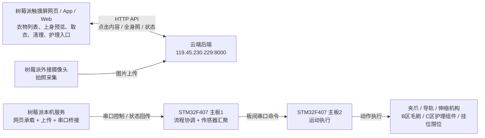

# 云端后端到树莓派与双主板技术链路

本文用于说明当前正式方案中的控制链路。虽然文件名沿用旧名称，但文档内容已经按最新方案更新，不再把 K230 作为当前正式主线。

当前正式主线为：

`树莓派触摸屏网页 + 树莓派外接摄像头 -> 云端后端 -> 树莓派串口 -> 主板1 -> 主板2 -> 机构执行`

## 1. 总体链路



当前链路可以概括为两层：

1. 上层：
   树莓派触摸屏网页、App / Web 和云端后端之间的交互，负责用户意图、衣物数据和任务管理。
2. 下层：
   树莓派通过串口把控制信息送给主板1，主板1再协调主板2执行电机和机构动作。

## 2. 树莓派网页 / App 到后端

树莓派触摸屏网页和 App / Web 都通过 HTTP API 与云端交互。当前可确认的接口包括：

| 方法 | 路径 | 用途 |
|---|---|---|
| `GET` | `/api/wardrobe` | 获取衣物列表 |
| `POST` | `/api/wardrobe/add` | 上传图片并新增衣物 |
| `POST` | `/api/wardrobe/{itemId}/status` | 更新衣物状态 |
| `POST` | `/api/hardware/fetch` | 发起取衣任务 |
| `POST` | `/api/hardware/care` | 发起清理 / 护理任务 |
| `POST` | `/api/ai/generate` | 推荐 / 上身效果预览 |

在当前正式方案中，树莓派网页的作用不是直接控制电机，而是把用户点击和参数发送到云端，由云端生成任务和控制意图。

## 3. 树莓派摄像头到后端

当前正式方案中，拍照与上传由树莓派负责，基本流程如下：

1. 树莓派控制外接摄像头拍照。
2. 读取图像文件或图像流。
3. 将图片转换成云端可接收的格式，例如 `image_base64`。
4. 调用云端 `POST /api/wardrobe/add`。
5. 获取云端返回的识别结果、衣物 ID、样式信息和状态。
6. 前端刷新衣物列表，必要时把状态通过串口传给主板1参与后续流程。

建议树莓派上传采用以下数据口径：

```json
{
  "image_base64": "data:image/jpeg;base64,...",
  "source": "raspberry_pi_camera"
}
```

## 4. 树莓派到主板1串口链路

当前正式方案中，树莓派通过串口连接主板1。这条链路的作用是把上层的控制意图接入底层控制系统。

建议这条链路承载两类信息：

| 类型 | 说明 |
|---|---|
| 控制信息 | 取衣、护理、清理、急停、状态查询等 |
| 状态信息 | 主板1传感器数据、动作阶段、异常状态、任务结果 |

正式文档中应把这条链路描述为：

`树莓派边缘接入串口`

而不是旧的 `K230 UART 视觉链路`。

## 5. 主板1职责

主板1在当前方案中是系统调度中枢，负责：

- 接收树莓派串口指令
- 汇聚多源传感器数据
- 进行状态判定和流程编排
- 向主板2下发动作命令
- 管理本地状态显示和异常反馈

当前明确接入主板1的数据包括：

- 除湿袋重力传感器
- 温湿度传感器
- 挂位限位开关点位检测
- 本地按键和状态量

## 6. 主板1到主板2

主板1通过板间串口把动作命令发给主板2。主板2只负责动作执行，不负责视觉、联网和云端接口。

这条链路在正式方案中继续保留原有分层关系：

- 主板1：判定与调度
- 主板2：动作执行

## 7. 旧 K230 资料的定位

K230 相关脚本、串口协议、配网流程、图片透传逻辑，当前都不再属于正式交付链路。

它们的定位应统一写成：

- 历史调试资料
- 旧方案实现参考
- 可归档但不纳入当前正式主线

因此，后续如果在答辩、方案书或说明文档中提到 K230，必须明确说明它是历史方案，而不是当前正式架构的一部分。
