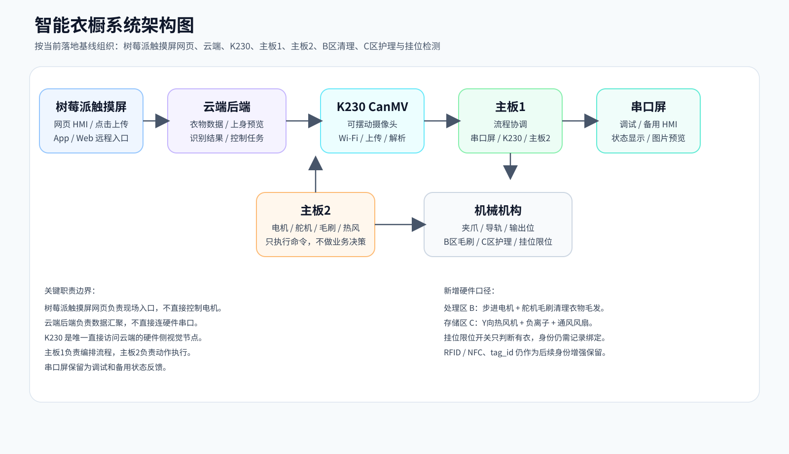
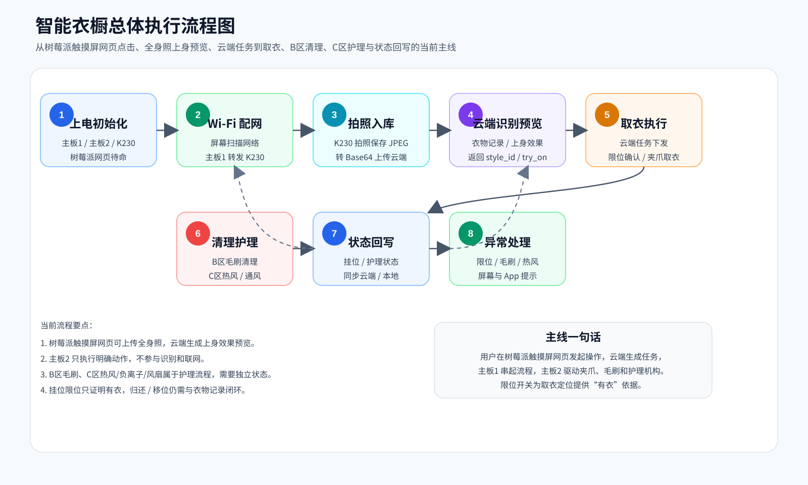
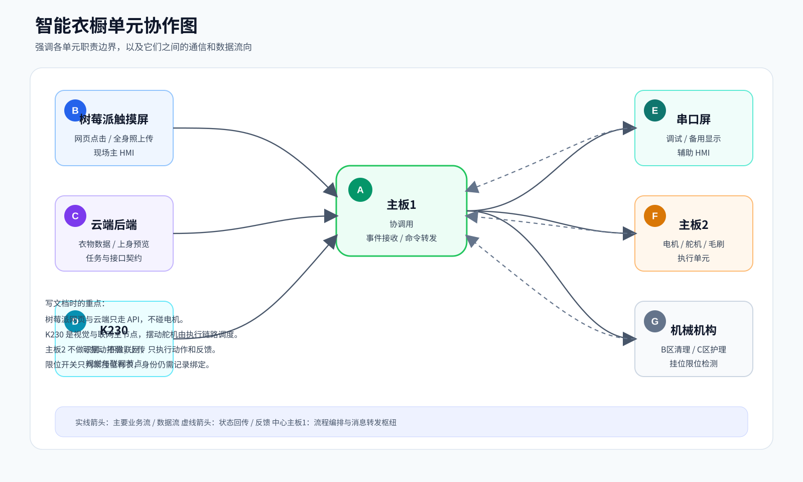

# 智能衣橱系统总览与执行流程

## 0. 文档定位

本文用于汇总智能衣橱当前系统架构、技术链路、执行流程与申报材料可用内容。阅读对象可以不熟悉本工程，也可以不了解当前仓库中的固件、树莓派触摸屏网页、树莓派摄像头接入方案和 App 代码。本文的目标是帮助读者建立完整的系统认识，并为设计说明、接口说明、验收材料和作品申报书提供统一依据。

本文不是单个模块的开发手册，而是系统级说明。它重点回答以下问题：

- 这个智能衣橱项目要实现什么目标
- 当前工程实际采用了哪些硬件和软件单元
- 每个单元承担什么职责，不承担什么职责
- 系统上电后如何运行
- 树莓派触摸屏网页、树莓派摄像头、App、云端、主板1、主板2之间如何协作
- 哪些功能已经有代码或脚本支撑
- 当前能力、规划预留和历史方案之间的边界
- 申报材料、展示材料和技术说明可采用的统一表述

当前系统以本文所列的“当前基线”为准。旧材料中出现过“ESP32-S3 作为当前业务网关”“RFID/NFC 作为当前身份闭环主线”等说法，已经不再作为当前实现口径。当前 `slot_id` 先与挂位限位开关和夹爪坐标绑定；RFID/NFC 与 `tag_id` 属于后续身份增强方向。

---

## 1. 项目概述

### 1.1 项目目标

智能衣橱系统的目标不是简单地控制电机移动衣物，而是建立一套“衣物识别、数据管理、本地交互、机械执行、状态同步”的闭环系统。

系统希望实现的核心能力包括：

| 能力 | 说明 |
|---|---|
| 衣物识别 | 通过树莓派外接摄像头拍照，将图片上传至云端，由云端识别衣物信息 |
| 衣物建档 | 云端保存衣物名称、图片、状态、样式等数据 |
| 衣物查询 | 树莓派触摸屏网页、App / Web 从云端获取衣物列表，供用户查看和选择 |
| 本地交互 | 树莓派连接触摸屏并运行网页，用户点击后直接把控制意图发送到云端，由云端统一驱动系统链路 |
| 上身预览 | 用户上传个人全身照，选择目标衣物后由云端生成上身效果预览 |
| 取衣执行 | 主板1向主板2下发动作命令，主板2控制电机和机构执行 |
| 衣物清理 | 在处理区 B 通过步进电机和舵机驱动毛刷上下清理衣物表面附着毛发 |
| 衣物护理 | 在存储区 C 通过可沿 Y 方向移动的热风机、顶部负离子发生器和通风风扇进行烘干、除味和通风辅助 |
| 挂位检测 | 每个伸缩杆挂衣点设置限位开关，用于判断该点位是否已经挂上衣服 |
| 状态同步 | 衣物入库、取出、归还、异常等状态回写到云端或本地显示 |
| 异常处理 | 摄像头、Wi-Fi、上传、串口、机械动作等异常需要被识别和提示 |

从技术文档角度看，本系统应被描述为一个多单元协作系统，而不是某一块单板或某一个 App 的独立功能。

### 1.2 当前落地基线

当前工程实际采用的主线架构如下：

| 单元 | 当前定位 |
|---|---|
| 树莓派触摸屏网页 | 现场主 HMI，树莓派连接触摸屏运行网页，用户点击后把操作内容上传云端 |
| 树莓派外接摄像头 | 当前视觉采集入口，由树莓派控制拍照并上传图片，同时通过串口与主板1通信 |
| App / Web | 用户侧远程入口，负责衣物浏览、图片上传、全身照上传、上身预览、取衣请求、状态更新 |
| 云端后端 | 数据汇聚点，负责衣物数据、图片、状态和识别结果 |
| K230 / 串口屏历史资料 | 已归档，不纳入当前运行链路，仅在历史资料或旧调试方案中出现 |
| STM32F407 主板1 | 系统协调板，负责树莓派串口、主板2、OLED、按键、除湿袋重力传感器、温湿度传感器和挂位限位开关等链路 |
| STM32F407 主板2 | 运动执行板，负责步进电机、伸缩轴、舵机、毛刷、热风机移动、回零与调试动作 |
| 机械机构 | 夹爪、导轨、伸缩机构、输出位、处理区 B 毛刷、存储区 C 热风/负离子/通风组件、挂位限位开关等实际动作对象 |

现场人机交互由“树莓派 + 外接触摸屏 + 网页”承担。网页直接把用户点击、选择和任务参数发送到云端，不直接驱动电机；云端根据这些操作生成控制意图，再由树莓派通过串口把控制信息送给主板1，由主板1和主板2完成后续执行。当前拍照和图片上传能力由树莓派外接摄像头承担。主板1不直接访问云端，主板2不参与识别和联网；K230和串口屏资料仅作为历史归档，不属于当前运行方案。

### 1.3 旧方案修正

后续编写技术文档时，应特别注意以下口径：

| 历史或旧方案说法 | 当前应采用的说法 |
|---|---|
| ESP32-S3 是业务网关 | 当前主线中树莓派承担网页、人机交互、摄像头接入与云端通信，ESP32-S3 仅作为历史资料或后续可选扩展 |
| RFID/NFC 负责当前衣物身份闭环 | RFID/NFC 尚未接入当前代码主流程，只能写为后续库存一致性增强方案 |
| `tag_id` 是当前必备字段 | `tag_id` 是预留字段，可在后续 RFID/NFC 接入时使用 |
| `slot_id` 已经完整闭环 | 当前已具备挂位限位检测基础，但 `slot_id` 与数据库、动作反馈和衣物身份仍需继续闭环 |
| K230 还是当前视觉主单元 | 当前正式方案中已切换为树莓派外接摄像头拍照上传，K230仅作为历史方案保留 |

---

## 2. 术语说明

为了避免后续文档出现概念混乱，建议统一使用以下术语。

| 术语 | 解释 |
|---|---|
| 智能衣橱 | 整套系统名称，包含前端、云端、树莓派、两块 STM32 和机械结构 |
| 树莓派触摸屏网页 | 现场主交互入口，树莓派连接触摸屏并运行网页，点击操作通过 HTTP 上传云端 |
| 树莓派外接摄像头 | 接在树莓派上的图像采集设备，由树莓派控制拍照并上传到云端 |
| App / Web | 用户侧软件入口，用于查看衣物、上传图片、发起取衣或更新状态 |
| 云端后端 | 部署在服务器上的 API 服务，当前地址从 App 和树莓派侧调用中反推出为 `119.45.230.229:8000` |
| K230 CanMV | 历史视觉模块，旧方案中承担拍照、上传和结果解析，当前不再属于正式链路 |
| 主板1 | STM32F407 协调板，负责树莓派串口、板间链路、本地传感器和流程编排 |
| 主板2 | STM32F407 执行板，负责电机、舵机和机构动作 |
| 串口屏 | 历史调试/展示资料，对应旧的本地屏幕方案，不纳入当前交付链路 |
| HMI | Human Machine Interface，人机交互界面，本项目中指树莓派外接触摸屏上运行的网页界面 |
| UART / USART | 串口通信接口，当前主线用于树莓派与主板1、主板1与主板2等硬件链路通信 |
| 处理区 B | 衣物清理处理位置，新增由步进电机和舵机带动的毛刷工具，用于清理衣物表面毛发 |
| 存储区 C | 衣物存放区域，新增可沿 Y 方向移动的热风机、顶部负离子发生器和通风风扇 |
| 毛刷工具 | 安装在处理区 B 的清理机构，通过电机和舵机实现上下接近、摆动或清扫动作 |
| 热风机 | 位于存储区 C 衣物下方的护理执行件，可沿 Y 方向移动，对不同挂位进行热风处理 |
| 负离子发生器 | 位于存储区 C 顶部的空气护理部件，用于除味、净化或辅助衣物护理 |
| 通风风扇 | 位于存储区 C 顶部的气流组织部件，用于通风、散湿和热风后的空气循环 |
| 挂位限位开关 | 安装在伸缩杆各挂衣点位的检测开关，用于判断该挂位是否有衣物悬挂 |
| `image_base64` | 图片以 Base64 Data URL 形式上传给云端的字段 |
| `style_id` | 云端返回的衣物样式编号，可由树莓派侧读取并用于前端展示或后续流程 |
| `tag_id` | 预留衣物标签 ID，适用于未来 RFID/NFC 接入 |
| `slot_id` | 挂位 ID，建议与伸缩杆点位和限位开关状态绑定，用于取衣定位和库存一致性 |
| 上身效果预览 | 用户上传全身照后，云端结合目标衣物生成的试穿预览图 |
| `try_on_image` | 上身效果预览图字段，建议用于保存或返回预览结果地址 |
| OLED | 主板1上的小显示屏，用于显示调试状态，例如挂位限位状态、通信状态或任务阶段 |

---

## 3. 系统总体架构



系统可以按职责拆分为六个层次。

| 层次 | 组成 | 主要职责 |
|---|---|---|
| 交互层 | 树莓派触摸屏网页、App / Web | 现场触摸操作、远程操作、全身照上传、上身预览、状态展示 |
| 数据层 | 云端后端 | 衣物数据、图片数据、状态数据、识别结果 |
| 视觉与边缘接入层 | 树莓派外接摄像头、树莓派本机服务 | 拍照、图片上传、串口桥接、前端触发与本地边缘接入 |
| 协调层 | STM32F407 主板1 | 编排流程，连接树莓派、主板2和本地传感器 |
| 执行层 | STM32F407 主板2、驱动与开关量接口 | 电机、舵机、伸缩轴、毛刷、热风机 Y 向移动、回零和测试动作 |
| 机构层 | 夹爪、导轨、伸缩机构、输出位、B 区毛刷、C 区护理组件、挂位限位开关 | 执行真实物理动作并提供挂位占用反馈 |

### 3.1 架构理解重点

系统架构包含以下关键关系：

1. 树莓派触摸屏网页和 App / Web 不直接控制电机，主要通过云端接口表达业务意图。
2. 云端后端不直接连接硬件串口，主要处理图片、识别和衣物状态。
3. 树莓派是硬件侧直接访问云端并控制摄像头的边缘节点，负责拍照上传和与主板1的串口桥接。
4. 主板1是协调中心，负责把树莓派、主板2和本地输入组合成流程。
5. 主板2是执行中心，只处理动作命令，不处理云端接口和视觉识别。
6. 树莓派触摸屏网页是现场主交互入口，用户点击先到云端，再由云端驱动整个系统链路。
7. 处理区 B 和存储区 C 的新增机构属于执行与护理链路，不改变“树莓派拍照上传、主板1协调、主板2执行”的主线边界。
8. 挂位限位开关只能说明某个点位是否有衣物，不能单独证明衣物身份；完整闭环仍需把 `slot_id`、衣物 ID 和云端状态绑定起来。

系统框图应采用“树莓派触摸屏网页 / 树莓派摄像头 / App / Web -> 云端 -> 树莓派串口 -> 主板1 -> 主板2 -> 机构”这条主线。

---

## 4. 各单元功能说明

### 4.1 树莓派触摸屏网页与 App / Web 控制端

树莓派触摸屏网页是现场主 HMI。树莓派连接触摸屏，在本地浏览器中运行网页；用户在触摸屏上点击衣物、选择功能或发起清理 / 护理任务后，网页把这些操作内容上传到云端。App / Web 则作为远程或通用用户侧入口，让用户查看衣橱、上传图片、选择衣物和发起操作。

当前从 APK 和原型中可以确认或反推出以下能力：

| 功能 | 说明 |
|---|---|
| 衣物列表 | 树莓派网页或 App 通过 `GET /api/wardrobe` 获取衣物数据 |
| 图片入库 | 用户选择图片后，转为 Base64 Data URL 并调用 `POST /api/wardrobe/add` |
| 上身预览 | 用户上传个人全身照并选择衣物，云端生成上身效果预览并返回网页显示 |
| 状态更新 | 调用 `POST /api/wardrobe/{itemId}/status` 同步衣物状态 |
| 硬件取衣入口 | 树莓派触摸屏网页点击后通过 `POST /api/hardware/fetch` 发起取衣意图 |
| 清理 / 护理入口 | 树莓派触摸屏网页上传 B 区毛刷清理、C 区热风护理等任务参数 |
| AI 推荐入口 | 通过 `POST /api/ai/generate` 获取推荐结果 |
| 日志或接口显示 | 原型中存在接口参数和运行日志展示能力 |

技术文档中应说明：树莓派触摸屏网页和 App / Web 是业务入口，不直接控制主板2的电机。网页点击上传到云端后，云端负责生成控制意图；电机动作由硬件侧流程接管。

### 4.2 云端后端

云端后端是数据汇聚点。当前工作区没有找到后端源码，因此后端能力主要来自 App 和树莓派侧调用方式的反推。

云端应承担的职责包括：

| 职责 | 说明 |
|---|---|
| 接收图片 | 接收 App 或树莓派上传的 `image_base64` |
| 接收全身照 | 接收用户上传的个人全身照，用于生成上身效果预览 |
| 视觉识别 | 对衣物图片进行品类、样式或属性识别 |
| 上身预览生成 | 根据用户全身照、衣物图片和衣物属性生成上身效果预览图 |
| 数据保存 | 保存衣物 ID、名称、图片地址、状态、样式等字段 |
| 状态管理 | 维护 `in-wardrobe`、`in-use`、`pending`、`error` 等状态 |
| 列表查询 | 为树莓派触摸屏网页和 App / Web 提供衣物列表 |
| 任务下发 | 接收触摸屏网页上传的点击和任务参数，生成取衣、清理、护理等控制意图 |
| 推荐与预览 | 为搭配推荐、AI 生成和上身效果预览提供接口 |

当前后端接口建议保持以下基础契约：

| 方法 | 路径 | 说明 |
|---|---|---|
| `GET` | `/api/wardrobe` | 获取衣物列表 |
| `POST` | `/api/wardrobe/add` | 新增衣物或识别入库 |
| `POST` | `/api/wardrobe/{itemId}/status` | 更新衣物状态 |
| `POST` | `/api/hardware/fetch` | 发起硬件取衣请求 |
| `POST` | `/api/ai/generate` | 获取 AI 推荐、搭配生成或上身效果预览 |

### 4.3 树莓派外接摄像头与串口桥接

当前正式方案中，视觉采集与边缘接入由树莓派承担。树莓派一侧连接外接摄像头完成拍照，并通过网络访问云端；另一侧通过串口与主板1通信，把上层任务和底层执行链路衔接起来。

树莓派侧当前应承担的职责包括：

| 职责 | 说明 |
|---|---|
| 摄像头采集 | 通过外接摄像头拍照，获取衣物图片 |
| 图片上传 | 将图片上传到云端接口，如 `POST /api/wardrobe/add` |
| 前端承载 | 在本地浏览器中运行触摸屏网页，接收用户点击 |
| 串口桥接 | 通过串口把与执行相关的控制意图发送给主板1 |
| 结果回显 | 从云端读取识别结果和状态，并反馈到网页界面 |

树莓派侧的主逻辑应按下面理解：

1. 树莓派运行触摸屏网页和本地边缘服务。
2. 用户在网页上发起入库、取衣、护理等操作。
3. 树莓派控制外接摄像头拍照。
4. 将图片转为适合上传的格式并调用云端接口。
5. 获取云端返回的识别结果或任务状态。
6. 需要进入执行链路时，通过串口把控制信息发送给主板1。
7. 主板1根据传感器状态和任务逻辑，决定是否转发给主板2执行。

技术文档应明确：树莓派负责“拍照上传 + 前端承载 + 串口桥接”，但不直接承担电机执行；真正的运动执行仍由主板1/主板2链路完成。K230相关内容在当前方案中只作为历史实现保留，不再作为正式架构描述。

### 4.4 STM32F407 主板1

主板1是当前系统的协调板。它的核心价值是把各个单元串成流程，而不是替代所有模块完成业务。

主板1入口文件：

- `代码/4.11/主板1/USER/main.c`

主板1当前初始化的关键模块包括：

| 初始化调用 | 说明 |
|---|---|
| `Board1_LinkUart_Init(115200)` | 初始化主板1到主板2的板间串口 |
| `board1_uart3_k230_init(115200)` | 初始化主板1到树莓派串口桥接链路的 UART3 |
| `board1_uart6_screen_init(115200)` | 初始化主板1到历史/调试屏接口的 UART6 |
| `KEY_Init()` | 初始化按键 |
| `OLED_Init()` | 初始化 OLED |
| `Control_Init()` | 初始化控制相关状态 |

主板1主循环当前执行：

| 循环任务 | 说明 |
|---|---|
| `board1_k230_service()` | 当前可重定义为树莓派串口服务，处理拍照触发、状态回传和执行前串口交互 |
| `board1_screen_service()` | 处理历史/调试屏保留的 Wi-Fi 扫描、选择、连接等事件 |
| `board1_oled_show_status()` | 周期性显示限位开关状态、通信状态等调试信息 |

主板1与其他单元的关系：

| 连接对象 | 通道 | 主要内容 |
|---|---|---|
| 树莓派串口链路 | USART3 / UART3 | 拍照触发、任务控制意图、状态回传、必要的图片相关信息 |
| 串口屏（历史/调试保留） | USART6 / UART6 | 旧屏幕事件和图片写入接口，不属于当前主交互链路 |
| 主板2 | 板间 USART | 运动命令帧 |
| OLED | 本地显示接口 | 调试状态 |
| 按键 / 限位开关 | GPIO / 开关量输入 | 触发条件、挂位占用与现场状态 |

主板1定位为“协调板”或“流程编排板”，负责通信协调、流程编排、传感器状态汇聚和任务转发，不承担全部业务执行。

### 4.5 树莓派触摸屏网页（当前主 HMI）

当前现场主 HMI 是“树莓派 + 外接触摸屏 + 网页”。树莓派负责运行浏览器或本地网页壳，触摸屏负责用户点击；网页把点击内容、衣物 ID、挂位、清理模式、护理模式等参数直接发送到云端。云端统一生成控制意图，再由树莓派串口、主板1、主板2接力执行整个系统。

当前文档口径中，串口屏不再作为现场交互、配网或控制入口。与串口屏相关的页面、协议和导入资料仅作为历史归档保留，用于回溯旧方案或查看曾经的调试实现，不纳入当前交付链路。

树莓派触摸屏网页侧需要重点描述的能力包括衣物列表、取衣按钮、B 区毛刷清理按钮、C 区护理按钮、任务进度、异常提示和云端连接状态。正式展示中，树莓派网页定位为“现场人机交互主入口”，用户点击先到云端，再由云端驱动整个系统。

树莓派触摸屏网页和 App / Web 的当前能力包括“上传全身照并预览上身效果”。用户上传个人全身照并选择某件衣物后，网页把全身照、衣物 ID 和衣物图片信息上传云端，云端生成上身效果预览图后返回前端显示。该功能用于用户在取衣前判断穿搭效果，不直接参与电机控制。

### 4.6 STM32F407 主板2

主板2是运动执行板。它不处理云端，不处理视觉，不直接响应 App，而是接收主板1下发的动作命令并控制执行机构。

主板2入口文件：

- `代码/4.11/主板2/USER/main.c`

主板2当前主要能力：

| 能力 | 说明 |
|---|---|
| 板间命令接收 | 通过 USART1 接收主板1命令 |
| 步进电机控制 | 支持多路步进电机控制 |
| X 轴双电机 | UART2 双电机反向联动 |
| Y 轴控制 | UART3 |
| Z 轴控制 | UART4 |
| 伸缩轴控制 | UART5 |
| 舵机控制 | TIM1 PWM |
| 处理区 B 毛刷 | 步进电机与舵机组合驱动，支持毛刷上下接近衣物并清理表面附着毛发 |
| K230 摆动支架 | 通过舵机让可移动端平台上的摄像头上下摆动，辅助拍照和复拍 |
| 存储区 C 热风机 | 位于衣物下方，可沿 Y 方向自由移动，对不同挂位进行热风护理 |
| 负离子与通风组件 | 顶部负离子发生器和通风风扇用于除味、净化、散湿和空气循环 |
| 挂位限位开关 | 每个挂衣点位配置开关输入，用于判断该点位是否已经挂上衣服 |
| 按键测试 | 支持按键触发测试动作 |
| 回零动作 | 支持按累计角度或固定角度回零 |

技术文档中应把主板2描述为“执行单元”。如果需要写动作链路，应强调动作意图来自主板1，主板2只负责执行。

### 4.7 传感器与机械机构

当前工程中涉及的传感器与机构包括：

| 类型 | 说明 |
|---|---|
| 按键 | 用于调试、触发拍照或测试动作 |
| 步进电机 | 控制 X/Y/Z/伸缩等轴运动 |
| 舵机 | 控制夹爪或辅助机构角度 |
| 处理区 B 毛刷工具 | 由步进电机和舵机带动，上下接近衣物并清理衣物表面毛发 |
| 可摆动 K230 摄像头 | 安装在移动端平台上，通过舵机上下摆动以获得不同观察角度 |
| 存储区 C 热风机 | 放在衣物下方，可沿 Y 方向移动，对目标挂位进行热风处理 |
| 存储区 C 顶部护理组件 | 负离子发生器和通风风扇用于空气净化、除味、散湿和通风 |
| 挂位限位开关 | 每个挂衣点位检测是否有衣物，为夹爪定位和取衣前校验提供输入 |
| 夹爪 / 导轨 / 输出位 | 完成取衣、移动、输出等物理动作 |

这些硬件本身不进行业务决策。业务决策来自主板1的状态机或上层业务请求。

---

## 5. 总体执行流程



### 5.1 上电启动流程

系统启动可以按以下顺序理解：

| 顺序 | 执行单元 | 动作 |
|---:|---|---|
| 1 | 主板1 | 初始化时钟、控制模块、板间串口、K230 串口、历史/调试屏接口、按键、OLED |
| 2 | 主板2 | 初始化板间串口、步进电机、舵机、按键服务和定时节拍 |
| 3 | K230 | 初始化摄像头、显示预览、UART、按键 |
| 4 | K230 | 因 `WIFI_AUTO_CONNECT_ON_BOOT = False`，按当前配置等待联网参数或执行既定联网流程 |
| 5 | 树莓派触摸屏 | 启动浏览器或网页程序，加载现场 HMI 页面 |
| 6 | 云端 | 等待树莓派网页、App 或树莓派侧拍照上传请求，并准备生成控制任务 |

启动流程可概括为“各模块分别初始化，然后通过串口和 HTTP 建立协作关系”。

### 5.2 树莓派联网与摄像头准备流程

树莓派能否访问云端，以及外接摄像头能否正常拍照，是入库、识别和取衣任务的前置条件。当前正式方案的准备流程应按下面理解：

```text
树莓派触摸屏网页 -> 树莓派摄像头拍照 / 上传 -> 云端任务 / 状态 -> 树莓派串口 -> 主板1 / 主板2执行
```

当前文档口径下，准备流程可分为四步：

| 步骤 | 执行单元 | 内容 |
|---:|---|---|
| 1 | 现场运维 / 树莓派 | 确认现场网络可用，树莓派触摸屏网页可以访问云端 |
| 2 | 树莓派 | 确认外接摄像头可用，能够正常拍照或读取图像 |
| 3 | 树莓派 | 连网后可访问 `POST /api/wardrobe/add`、任务接口和状态接口 |
| 4 | 系统 | 树莓派负责网页交互、拍照上传和串口桥接，主板链路负责执行 |

树莓派到主板1的串口链路应作为当前正式接入方式描述；旧的 K230 / 串口屏联网和配网流程只作为历史方案保留，不再写成当前现场主流程。

### 5.3 衣物拍照与入库流程

衣物入库识别是当前系统最重要的业务链路。该链路涉及树莓派、云端、主板1，以及树莓派触摸屏网页 / App / Web。

```text
现场触发 -> 树莓派摄像头拍照 -> 云端 -> 树莓派 / 主板1状态 -> 前端刷新
```

详细流程：

| 步骤 | 执行单元 | 内容 |
|---:|---|---|
| 1 | 用户 / 现场 | 放入衣物，或通过前端操作进入拍照窗口 |
| 2 | 树莓派 | 控制外接摄像头拍照并获取衣物图片 |
| 3 | 树莓派 | 确认网络可用，并将图片转为适合上传的格式 |
| 4 | 树莓派 | 调用云端 `POST /api/wardrobe/add` |
| 5 | 云端 | 保存图片并识别衣物，返回结果 |
| 6 | 树莓派 | 解析返回内容，提取 `style_id`、图片地址、衣物状态等字段 |
| 7 | 树莓派 | 如有必要，通过串口把相关状态或后续控制信息发送给主板1 |
| 8 | 主板1 | 根据返回结果更新本地状态或后续动作条件 |
| 9 | 树莓派触摸屏网页 / App / Web | 下一次拉取列表或任务状态时显示新衣物 |

该流程中，云端是否真正完成识别取决于后端实现。当前本地仓库未包含后端源码，因此文档中需要标注“后端能力由接口调用反推”。

### 5.4 用户全身照上身效果预览流程

上身效果预览是当前系统已经具备的用户体验能力。它不属于后续规划，也不属于机械执行流程，而是云端生成和前端展示链路。

| 步骤 | 执行单元 | 内容 |
|---:|---|---|
| 1 | 用户 | 在树莓派触摸屏网页或 App / Web 中选择上身预览 |
| 2 | 用户 | 上传个人全身照，或选择已保存的全身照 |
| 3 | 用户 | 从衣物列表中选择目标衣物 |
| 4 | 树莓派网页 / App / Web | 上传全身照、衣物 ID、衣物图片或衣物属性到云端 |
| 5 | 云端 | 根据用户全身照和目标衣物生成上身效果预览图 |
| 6 | 树莓派网页 / App / Web | 显示预览结果 |
| 7 | 用户 | 根据预览结果决定是否取衣、清理或护理 |

该流程可以与取衣流程衔接：用户先预览上身效果，确认满意后再点击取衣，云端再生成硬件取衣任务。

### 5.5 取衣流程

取衣流程是从用户选择衣物到机械输出衣物的链路。当前工程已经具备主板2执行能力和板间通信基础，但完整业务状态机仍需进一步固化。

建议按以下目标流程描述：

| 步骤 | 执行单元 | 内容 |
|---:|---|---|
| 1 | 用户 | 在树莓派触摸屏网页或 App / Web 选择目标衣物 |
| 2 | 树莓派网页 / App / Web | 把点击内容和目标衣物信息上传云端，发起取衣请求 |
| 3 | 云端 / 主板1 | 根据衣物状态、`slot_id` 和挂位限位开关状态生成取衣意图 |
| 4 | 主板1 | 读取目标挂位限位开关，确认该点位确实有衣物 |
| 5 | 主板1 | 进入取衣动作流程，生成运动命令 |
| 6 | 主板1 | 通过板间串口向主板2发送 7 字节命令帧 |
| 7 | 主板2 | 控制步进电机、伸缩轴、舵机执行动作，让夹爪移动到目标挂位并夹取 |
| 8 | 机构 | 将衣物移动到输出位，或先移动到处理区 B 进行清理 |
| 9 | 系统 | 更新状态为 `in-use`、`cleaning` 或其他业务状态 |

当前取衣链路具备基础执行能力，完整取衣状态机、动作完成反馈和异常处理仍需继续完善。

### 5.6 归还与移位流程

归还和移位是库存一致性要求更高的流程。当前仓库中已有树莓派复拍能力、主板2动作能力和云端接口口径，但完整闭环仍需继续实现。

推荐目标流程：

| 步骤 | 执行单元 | 内容 |
|---:|---|---|
| 1 | 用户 | 将衣物放回或发起移位 |
| 2 | 主板1 | 通过按键、限位开关或状态量确认现场条件 |
| 3 | 主板1 | 读取目标挂位限位开关，确认衣物已经挂到指定点位 |
| 4 | 主板1 | 必要时通知树莓派重新拍照确认 |
| 5 | 树莓派 / 云端 | 识别或确认衣物信息 |
| 6 | 云端 | 更新衣物状态和挂位信息 |
| 7 | 主板1 | 向主板2下发回收、复位或移位命令 |
| 8 | 主板2 | 执行机构动作 |
| 9 | 系统 | 显示完成或异常状态 |

如果后续接入 RFID/NFC，应在此流程中增加 `tag_id` 校验，用于防止放错或拿错。

### 5.7 处理区 B 清理与存储区 C 护理流程

新增机构后，方案文档中应把“取衣”和“衣物护理”分开描述。取衣负责把目标衣物从挂位取出或送到输出位，B 区和 C 区则负责衣物表面清理、热风护理和空气循环。

处理区 B 毛刷清理推荐流程：

| 步骤 | 执行单元 | 内容 |
|---:|---|---|
| 1 | 主板1 | 根据取衣、护理或人工触发进入清理流程 |
| 2 | 主板2 / 机构 | 将目标衣物移动到处理区 B 的清理位置 |
| 3 | 树莓派摄像头 | 必要时在当前安装位置完成复拍确认 |
| 4 | 毛刷工具 | 步进电机驱动毛刷上下接近衣物，舵机调整接触角度或摆动姿态 |
| 5 | 主板2 | 按设定次数、行程或时间完成毛刷清理 |
| 6 | 主板1 | 清理结束后抬起毛刷，必要时通知树莓派复拍确认 |

存储区 C 护理推荐流程：

| 步骤 | 执行单元 | 内容 |
|---:|---|---|
| 1 | 主板1 | 根据挂位、衣物状态或护理任务选择目标区域 |
| 2 | 限位开关 | 检查目标挂位是否有衣物，避免对空挂位执行护理 |
| 3 | 热风机 | 在衣物下方沿 Y 方向移动到目标挂位，对衣物进行热风处理 |
| 4 | 负离子发生器 | 在顶部启动负离子护理，用于除味、净化或辅助空气处理 |
| 5 | 通风风扇 | 同步或延后启动通风，排出湿热空气并保持空气循环 |
| 6 | 系统 | 记录护理完成、超时或异常状态，并回写本地或云端 |

限位开关在这里承担“挂位占用确认”作用：某个挂衣点触发，说明该点位当前有衣物，可以作为夹爪取衣前的定位依据；但它不能替代视觉识别或衣物 ID 绑定，正式库存闭环仍需要 `slot_id` 与衣物记录一致。

### 5.8 异常处理流程

系统异常应统一回到主板1或云端状态。当前可识别或应预留的异常包括：

| 异常 | 可能来源 | 建议处理 |
|---|---|---|
| 摄像头失败 | 树莓派摄像头 | 返回拍照失败状态，树莓派触摸屏网页或 App 提示 |
| Wi-Fi / 网络失败 | 树莓派 / 网络环境 | 返回上传失败或网络异常状态 |
| 上传失败 | 树莓派 / 云端 | 返回上传失败状态 |
| 无识别结果 | 云端返回内容无法解析 | 返回 `STATUS_NO_RESULT` |
| 串口帧错误 | UART 通信 | 增加错误计数，必要时重试 |
| 图片传输失败 | 树莓派 / 主板1 | 停止传输，清理图片状态；主交互侧仍以树莓派触摸屏网页显示为准 |
| 动作未完成 | 主板2 / 机构 | 停止后续动作并提示人工处理 |
| 目标挂位无衣 | 挂位限位开关 | 不执行夹取，提示挂位状态与任务不一致 |
| 毛刷未到位 | 处理区 B 毛刷机构 | 停止清理动作，抬起毛刷并提示人工检查 |
| 热风或风扇异常 | 存储区 C 护理组件 | 停止热风、负离子和通风流程，避免长时间空转 |
| 状态不一致 | 云端 / 本地 / 机构 | 进入人工确认或恢复流程 |

正式技术文档中应把异常处理作为单独章节，不要只在流程图中简单带过。

---

## 6. 单元协作与协议边界



### 6.1 协作原则

本项目的协作原则可以概括为：

| 原则 | 说明 |
|---|---|
| 识别与执行分离 | 树莓派负责拍照上传和云端接入，主板2负责动作执行 |
| 决策与动作分离 | 主板1负责编排流程，主板2只执行明确命令 |
| 数据与交互分离 | 云端负责数据，树莓派触摸屏网页负责现场主交互 |
| 云端与硬件解耦 | 树莓派触摸屏网页和 App / Web 通过云端交互，硬件侧由主板1和树莓派串口协作 |
| 现场交互与执行分离 | 树莓派触摸屏网页只上传点击和任务参数，不直接输出电机脉冲或串口运动命令 |
| 检测与身份分离 | 限位开关负责判断挂位是否有衣物，衣物身份仍由云端记录、视觉识别或后续标签机制确认 |
| 清理与取衣分离 | 处理区 B 毛刷、存储区 C 护理组件属于取衣之外的护理流程，应单独建状态和异常处理 |
| 当前与规划分离 | 已有代码支撑的内容与后续规划必须分开描述 |

### 6.2 树莓派触摸屏网页 / App / Web 与云端接口

当前建议接口如下：

| 方法 | 路径 | 请求 | 返回 |
|---|---|---|---|
| `GET` | `/api/wardrobe` | 无 | 衣物数组 |
| `POST` | `/api/wardrobe/add` | `image_base64`，可选 `device_id/source/tag_id/slot_id/slot_occupied` | 新增衣物或识别结果 |
| `POST` | `/api/wardrobe/{itemId}/status` | `status` | 更新结果 |
| `POST` | `/api/hardware/fetch` | 目标衣物或任务参数，主要来自树莓派触摸屏网页点击 | 硬件任务结果 |
| `POST` | `/api/hardware/care` | 清理 / 护理任务参数，例如 B 区毛刷、C 区热风护理 | 护理任务结果 |
| `POST` | `/api/ai/generate` | 衣物、用户全身照和上下文 | 推荐结果或上身效果预览 |

建议基础衣物对象：

```json
{
  "id": "garment_001",
  "name": "白色短袖",
  "img": "http://119.45.230.229:8000/static/xxx.jpg",
  "status": "in-wardrobe",
  "style_id": 1,
  "try_on_image": "http://119.45.230.229:8000/static/tryon/xxx.jpg"
}
```

建议状态枚举：

| 状态 | 含义 |
|---|---|
| `in-wardrobe` | 衣物在衣橱中 |
| `in-use` | 衣物已取出或正在使用 |
| `pending` | 正在识别或等待确认 |
| `error` | 出现异常，需要人工处理 |
| `cleaning` | 正在处理区 B 进行毛刷清理 |
| `care` | 正在存储区 C 进行热风、负离子或通风护理 |

上身效果预览请求建议包含：

```json
{
  "task_type": "try_on",
  "user_full_body_image": "data:image/jpeg;base64,...",
  "item_id": "garment_001",
  "garment_image": "http://119.45.230.229:8000/static/xxx.jpg"
}
```

返回建议包含：

```json
{
  "ok": true,
  "try_on_image": "http://119.45.230.229:8000/static/tryon/xxx.jpg"
}
```

### 6.3 树莓派与主板1串口协议

当前正式方案中，树莓派通过串口与主板1通信，承担“边缘接入 + 上层桥接”的角色。该链路用于把前端/云端侧的控制意图送入主板控制链路，也可用于把主板状态回传给树莓派网页侧。

接线关系在正式文档中应描述为：

| 树莓派串口 | 主板1 |
|---|---|
| TX | RX |
| RX | TX |
| GND | GND |

该链路建议承载两类信息：

| 类型 | 内容 |
|---|---|
| 控制信息 | 取衣、清理、护理、急停、状态查询等控制意图 |
| 状态信息 | 主板1传感器状态、动作阶段、异常状态、任务结果 |

当前正式方案建议把这条链路定义为“树莓派边缘控制串口协议”，而不是再沿用 K230 的图像接收协议口径。只要能保证主板1正确收到控制意图并返回状态，这条协议的具体格式可以后续继续细化。

### 6.4 主板1与串口屏协议（历史/调试保留）

主板1与串口屏使用 USART6，波特率 115200。该接口对应旧的本地屏幕方案，当前运行架构不依赖它，但为保留历史实现和调试能力，文档仍在此记录。

屏幕到主板1的事件：

| 事件 | 说明 |
|---|---|
| `@WSCAN` | 请求扫描 Wi-Fi |
| `@WSEL|index` | 选择第 `index` 个 Wi-Fi |
| `@WCONN|password` | 使用密码连接当前选中 Wi-Fi |

主板1写回串口屏的控件：

| 控件 | 内容 |
|---|---|
| `wifi0` 到 `wifi7` | Wi-Fi 名称 |
| `wifi_ssid` | 当前选中 SSID |
| `wifi_status` | 扫描、连接、成功 IP 或失败原因 |
| `pic0` | 显示历史方案中传回的衣物图片 |

图片写入流程：

| 步骤 | 内容 |
|---:|---|
| 1 | 主板1发送 `twfile "ram/cloth.jpg",size` |
| 2 | 串口屏返回 `0xFE FF FF FF` 表示准备接收 |
| 3 | 主板1把历史图像链路的图片字节写入串口屏 |
| 4 | 串口屏返回 `0xFD FF FF FF` 表示写入完成 |
| 5 | 主板1设置 `pic0.path="ram/cloth.jpg"` |

### 6.5 主板1与主板2协议

主板2通过 USART1 接收主板1下发的板间运动命令。当前命令帧长度为 7 字节。

```c
typedef struct
{
    uint8_t header;
    uint8_t cmd_type;
    uint8_t channel;
    uint8_t control;
    uint16_t angle_deg;
    uint8_t checksum;
} Board2CommandFrame_t;
```

主要命令：

| 命令 | 说明 |
|---|---|
| `CMD_STEPPER_ENABLE` | 使能或关闭步进电机 |
| `CMD_STEPPER_MOVE_ANGLE` | 按角度运动 |
| `CMD_EMERGENCY` | 紧急处理入口 |

主板2运动通道：

| 轴或机构 | 通道 |
|---|---|
| X 轴 | UART2，双电机反向联动 |
| Y 轴 | UART3 |
| Z 轴 | UART4 |
| 伸缩轴 | UART5 |
| 舵机 | TIM1 PWM |
| 处理区 B 毛刷 | 建议作为独立步进电机 / 舵机通道，负责上下清理与接触角度 |
| 可摆动 K230 支架 | 建议作为独立舵机通道，负责摄像头上下摆动 |
| 存储区 C 热风机 Y 向移动 | 建议作为独立 Y 向步进通道或复用护理机构通道 |
| 负离子发生器 / 通风风扇 | 建议作为开关量或继电器输出通道 |
| 挂位限位开关 | 建议作为一组离散输入点，与挂位编号和 `slot_id` 对应 |

---

## 7. 当前实现状态

### 7.1 已有代码或脚本支撑的内容

| 模块 | 状态 | 证据 |
|---|---|---|
| App 后端地址 | 已明确 | APK 中 `API_BASE = http://119.45.230.229:8000` |
| App 衣物列表接口 | 已明确 | `GET /api/wardrobe` |
| App 图片入库接口 | 已明确 | `POST /api/wardrobe/add` |
| K230 拍照上传 | 已实现脚本 | `artifacts/canmv_main_button_upload_current.py` |
| K230 等待外部配网命令 | 已实现脚本 | `WIFI_AUTO_CONNECT_ON_BOOT = False`；联网参数可由主板1保留接口转发，但当前现场方案不再以串口屏作为正式入口 |
| K230 Wi-Fi 扫描和连接 | 已实现脚本 | `@WSCAN`、`@WCONN|ssid|password` |
| K230 UART 拍照命令 | 已实现脚本 | 支持 `CMD_CAPTURE` |
| K230 结果帧 | 已实现脚本 | `CMD_RESULT` 返回 `status/style_id` |
| 树莓派摄像头拍照上传 | 当前正式口径 | 树莓派控制外接摄像头拍照并上传云端 |
| 树莓派到主板1串口链路 | 当前正式口径 | 树莓派通过串口把控制意图送给主板1 |
| 主板1 UART3 | 已有可复用基础 | 当前应作为树莓派串口接入口进行重定义 |
| 主板1 串口屏服务 | 已实现 | `board1_screen_service()`；属于历史/调试保留接口 |
| 主板1 图片转发到屏幕 | 已实现 | UART3 收图，UART6 写 `ram/cloth.jpg`；不属于当前主交互链路 |
| 主板1到主板2板间链路 | 已有基础 | `Board1_LinkUart_Init(115200)` |
| 主板2步进与舵机执行 | 已有基础 | 主板2 `Stepper_Multi`、`control`、`TIM1` 相关模块 |
| 处理区 B 毛刷机构 | 新增硬件方案 | 由步进电机和舵机带动，上下清理衣物表面毛发，需在控制命令中固化动作流程 |
| 存储区 C 护理组件 | 新增硬件方案 | 热风机可沿 Y 方向移动，顶部配置负离子发生器和通风风扇 |
| 挂位限位开关 | 新增硬件方案 | 每个挂衣点位具备衣物占用检测，需与 `slot_id` 和夹爪定位流程绑定 |

### 7.2 由现有资料反推但未见源码的内容

| 内容 | 说明 |
|---|---|
| 云端后端源码 | 当前工作区未找到，接口能力由 App 和树莓派侧调用方式反推 |
| 视觉模型实现 | App 文案提到 Gemini，实际后端实现未在本地仓库中 |
| 数据库存储结构 | 当前只能根据接口字段推断 |
| 云端鉴权 | 当前树莓派上传与前端接口的正式鉴权方案未确认 |

### 7.3 仍需完善的内容

| 内容 | 说明 |
|---|---|
| 统一业务状态机 | 入库、取衣、归还、移位流程需要统一管理 |
| 主板2动作完成反馈 | 当前需要进一步固化动作完成、失败和异常回传 |
| 新增机构控制命令 | B 区毛刷、C 区热风机、负离子、风扇和限位开关需要补齐通道表、命令码和反馈码 |
| 树莓派触摸屏网页 HMI | 需要补衣物列表、任务进度、异常确认、上身效果预览等页面和接口 |
| 串口屏历史工程 | 可按需保留配网、状态显示和图片预览脚本，仅作为历史/调试资料 |
| 后端数据模型 | 需要明确衣物、挂位、事件、任务等表结构 |
| RFID/NFC 接入 | 尚未接入当前代码主流程 |
| `tag_id` / `slot_id` 闭环 | `slot_id` 应先与挂位限位开关绑定，`tag_id` 后续再与 RFID/NFC 或其他身份机制打通 |
| 安全与鉴权 | 树莓派上传和 App 接口需要正式鉴权策略 |

---

## 8. 申报与技术资料整理

本节汇总可直接用于申报材料、展示材料和技术说明的资料结构。

### 8.1 建议拆分的资料模块

资料可拆分为以下模块：

| 文档 | 建议内容 |
|---|---|
| 系统总体设计说明 | 项目目标、系统架构、模块边界、总体流程 |
| 硬件系统说明 | 主板1、主板2、树莓派触摸屏、树莓派摄像头、传感器、机构连接关系 |
| 软件模块说明 | App、云端、树莓派网页 / 拍照 / 串口桥接程序、主板1固件、主板2固件 |
| 通信协议说明 | HTTP API、树莓派网页到云端链路、树莓派到主板1串口协议、主板1-主板2协议 |
| 业务流程说明 | 启动、配网、入库识别、取衣、归还、异常恢复 |
| 处理与护理流程说明 | 处理区 B 毛刷清理、存储区 C 热风 / 负离子 / 通风护理、挂位限位检测 |
| HMI 交互说明 | 树莓派触摸屏网页页面、按钮、云端接口、点击事件、任务参数和异常提示 |
| 历史界面归档说明 | 串口屏历史页面、旧控件名和旧事件格式，仅作归档备注 |
| 数据模型说明 | 衣物、状态、图片、样式、未来挂位和标签字段 |
| 测试与验收说明 | 单元测试、联调流程、异常测试、验收标准 |
| 后续扩展说明 | RFID/NFC、挂位闭环、推荐算法、鉴权、安全策略 |
| 上身预览功能说明 | 用户全身照上传、目标衣物选择、云端生成预览图、前端显示结果 |

### 8.2 推荐整理顺序

申报资料和技术资料可按“系统总体、通信边界、业务流程、硬件软件、测试验收”的顺序整理。

1. “系统总体设计说明”用于说明整体架构和模块关系。
2. “通信协议说明”用于固定各单元之间的数据边界。
3. “业务流程说明”用于串联启动、配网、入库、取衣、归还、清理和护理流程。
4. “硬件系统说明”和“软件模块说明”分别展开结构实现和程序实现。
5. “测试与验收说明”以当前已实现能力作为可验证项。

### 8.3 申报材料表述建议

申报书、展示材料和技术说明中可采用以下表述：

- 当前联网和图片上传主线由树莓派外接摄像头与树莓派本机承担。
- RFID / NFC 可作为后续身份识别扩展方向。
- 云端接口依据 App、树莓派触摸屏网页和树莓派拍照上传链路的调用关系进行定义。
- 主板1负责通信协调和任务转发，主板2负责运动执行。
- 树莓派触摸屏网页上传用户点击和任务参数到云端，由云端生成控制意图。
- 用户上传全身照后，系统可生成目标衣物的上身效果预览。
- 取衣、清理、护理等动作流程以当前可验证的机构能力为基础继续完善。

### 8.4 申报材料中的技术边界

申报材料中可明确以下技术边界：

- 当前实现与后续规划的边界
- 云端源码缺失与接口反推的边界
- 树莓派与主板1职责边界
- 主板1与主板2职责边界
- 树莓派触摸屏网页与云端控制任务之间的边界
- 上身效果预览与机械取衣执行之间的边界
- B 区清理、C 区护理与取衣主流程之间的边界
- 限位开关“有衣检测”与衣物身份识别之间的边界
- 历史串口屏资料与当前树莓派触摸屏主交互的边界
- 机械执行能力与完整业务闭环之间的边界

### 8.5 建议保留的图

当前三张图可作为正式技术文档的基础图：

| 图片 | 用途 |
|---|---|
| `images/wardrobe-architecture.svg` | 系统架构图 |
| `images/wardrobe-flow.svg` | 总体执行流程图 |
| `images/wardrobe-collaboration.svg` | 单元协作与协议边界图 |

用于 Word 或 PPT 时，可将 SVG 转为 PNG 后插入；用于 Markdown 或网页资料时，可直接引用 SVG。

---

## 9. 相关文件索引

### 9.1 总览与方案文档

| 文件 | 说明 |
|---|---|
| [项目总览](../00_项目导航/README_项目总览.md) | 当前工程目录导航 |
| [智能衣橱方案介绍](./智能衣橱方案介绍.md) | 当前落地方案说明 |
| [云端后端到 K230 技术链路](./云端后端到K230技术链路.md) | 历史 K230 链路资料，仅作旧方案参考 |
| [串口屏落地实现方案 v2](../02_界面原型/serial_screen_tjc_package_v2/串口屏落地实现方案_v2.md) | 历史串口屏页面与旧落地规划 |

### 9.2 代码与脚本

| 文件 | 说明 |
|---|---|
| [主板1 入口](../代码/4.11/主板1/USER/main.c) | 主板1初始化和主循环 |
| [主板1 UART3 通信基础](../代码/4.11/主板1/HARDWARE/UART3_K230/board1_uart3_k230.c) | 当前可复用为树莓派串口接入口的 UART3 基础模块 |
| [主板1 串口屏通信](../代码/4.11/主板1/HARDWARE/UART6_SCREEN/board1_uart6_screen.c) | UART6 历史/调试屏事件和文件写入 |
| [主板2 入口](../代码/4.11/主板2/USER/main.c) | 主板2初始化和主循环 |
| [主板2 板间命令](../代码/4.11/主板2/HARDWARE/USART1.DMA/usartdma.c) | 主板2接收和处理运动命令 |
| [主板2 运动控制](../代码/4.11/主板2/HARDWARE/control/control.c) | X/Y/Z/伸缩轴和回零控制 |
| [K230 主脚本](../artifacts/canmv_main_button_upload_current.py) | 历史 K230 拍照、配网、上传和 UART 协议脚本 |

### 9.3 图片

| 文件 | 说明 |
|---|---|
| [系统架构图](./images/wardrobe-architecture.svg) | 当前系统模块和数据流 |
| [总体流程图](./images/wardrobe-flow.svg) | 配网、入库、取衣、归还和异常流程 |
| [协作协议图](./images/wardrobe-collaboration.svg) | 各单元协议边界和职责关系 |

---

## 10. 项目阶段性结论

本工程当前已经具备“树莓派触摸屏网页主交互、树莓派外接摄像头拍照上传、App / Web 入口、云端接口契约、主板1协调、主板2运动执行”的基础骨架。K230和串口屏相关内容只应作为历史归档或调试保留接口来描述，不再属于当前交付链路。

系统采用多单元协作架构，而不是单个控制板或单个 App 独立完成。当前资料中需要区分已实现内容、接口反推内容和后续规划内容，使读者能够准确理解当前工程已经具备的能力，以及仍需继续完善的部分。
