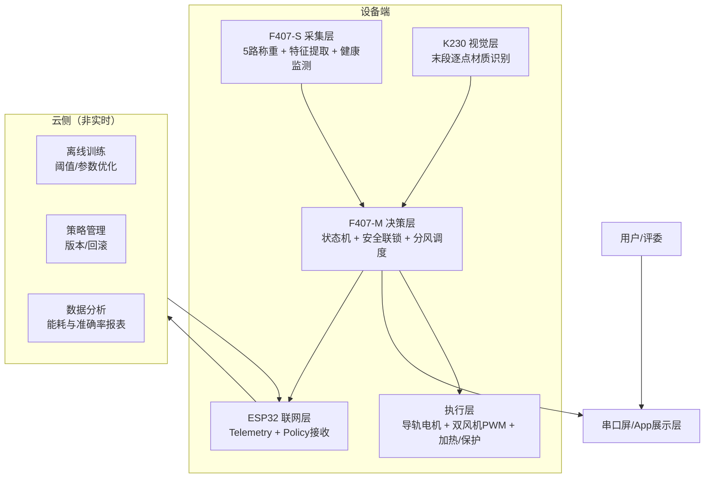
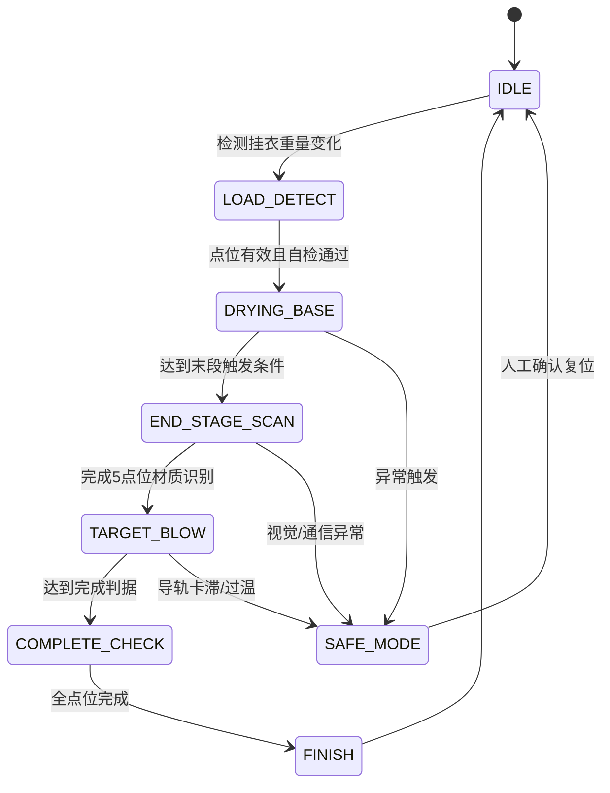

# 智能护衣系统全技术链路分析报告（5点位称重 + 双风机导轨 + 端云协同AI）

> 版本：v1.0  
> 日期：2026-03-27  
> 定位：竞赛答辩优先（可演示、可解释、可落地）

---

## 1. 摘要与边界

### 1.1 摘要

本方案采用“**5点位称重主判干 + K230末段材质识别 + 双风机导轨定点吹风 + 端云协同优化**”的闭环架构。  
核心目标是：在控制复杂度可控前提下，实现“防烘坏、不过烘、可量化节能”的智能护衣能力，并形成可直接用于答辩的技术证据链。

### 1.2 系统边界（锁定）

- 固定 5 个晾衣点位，每点 1 路拉力传感器。
- 两个风机安装在导轨上移动，按点位停靠进行定点吹风。
- K230 仅在烘干末段逐点识别材质，不直接驱动大功率执行器。
- 双 F407 分工：`F407-S`采集特征，`F407-M`状态机与执行控制。
- ESP32负责联网与数据上行/下发；云端仅做训练与策略管理，不参与硬实时控制。

### 1.3 非目标（本轮不闭环）

- 量产级认证与EMC细化设计。
- 完整云平台产品化与多租户权限体系。
- 全流程视觉检测（仅保留末段识别）。

---

## 2. 全链路架构

### 2.1 分层架构

### 2.2 控制主原则

- **安全优先于性能**：任何异常优先进入安全降级。
- **规则兜底优先于AI建议**：AI不可信时系统仍可稳定运行。
- **实时闭环只在本地**：云端参数不直接覆盖即时控制动作。

---

## 3. 工作流1：业务与工况链路（状态机）

### 3.1 全流程状态机

### 3.2 每阶段输入-决策-输出-降级

| 阶段 | 输入 | 决策 | 输出 | 降级动作 |
|---|---|---|---|---|
| LOAD_DETECT | 5点原始重量 | 是否有效挂载 | 建立本轮`session_id`与点位基线 | 无效点位屏蔽并提示 |
| DRYING_BASE | `w_filt/slope/var` | 是否进入末段 | 基础风干策略 | 超时进入保守完成 |
| END_STAGE_SCAN | 点位顺序、图像质量 | 是否可识别 | `material_id/conf` | 低置信度统一未知类 |
| TARGET_BLOW | 材质+干燥估计 | 分风调度 | 导轨移动与双风机占空比 | 导轨异常改全局低风 |
| COMPLETE_CHECK | `dry_conf/eta` | 是否完成 | 完成提示、日志归档 | 最大时长到达强制结束 |

---

## 4. 工作流2：机械与执行链路（双风机导轨）

### 4.1 执行机构定义

- 导轨：单轴水平导轨覆盖 5 个点位。
- 载体：双风机安装于同一滑台（或左右固定间距双滑台）。
- 停靠：每点位设逻辑停靠坐标 `P1...P5`，支持反向就近寻址。

### 4.2 核心机械参数建议（样机）

- 行程覆盖：`L_total >= P5 - P1 + 安全余量`
- 停靠精度：`<= ±5 mm`
- 单次停靠稳定时间：`300~800 ms`
- 单点位吹风驻留：`5~30 s`（按调度动态）

### 4.3 故障模式与补偿

| 风险 | 触发信号 | 检测方式 | 补偿策略 |
|---|---|---|---|
| 导轨卡滞 | 电流突增/位移不变 | 电机电流+超时 | 立即停机并退回安全位 |
| 停靠偏差 | 实际风场偏离 | 限位/编码器校验 | 二次微调后再吹风 |
| 风场不均 | 局部吹不到 | 覆盖测试不达标 | 增加驻留或调整停靠点 |
| 振动传导 | 称重抖动增大 | `var_short`异常 | 吹风采样降权 + 滤波加窗 |

> 结论：双风机导轨可落地，但比“5独立风扇”更依赖机械调试与容错控制。

---

## 5. 工作流3：传感与控制链路（5路称重主判据）

### 5.1 采样与特征提取（F407-S）

- 原始采样：`w_raw[i]`，建议 10~50 Hz。
- 滤波输出：`w_filt[i]`（EMA + 异常点剔除）。
- 时间特征：`slope_10m[i]`、`var_short[i]`、`plateau_score[i]`。
- 健康检测：通道断线、漂移、噪声过大标记到`health_flag`。

### 5.2 标定与抗串扰

- 零点标定：空载上电 + 周期性漂移修正。
- 量程标定：每点挂标准砝码建立线性系数。
- 串扰补偿：建立 5x5 简化补偿矩阵 `W_corr = M * W_meas`。
- 风振抑制：吹风阶段扩大平滑窗并对`slope`降权。

### 5.3 主控决策（F407-M）

- 主判干依据：重量平台度 + 斜率接近0 + 最小时长约束。
- 辅助判据：材质风险、运行时长、异常标志。
- 执行输出：导轨目标点、双风机占空比、温度上限、驻留时长。

---

## 6. 工作流4：视觉与AI链路（K230 + 端云协同）

### 6.1 K230末段识别策略

- 识别阶段：仅在末段触发，逐点位停靠拍摄。
- 分类类别：`COTTON / SYNTHETIC / WOOL_SILK / UNKNOWN`（首版）。
- 输出字段：`point_id, material_id, confidence, image_quality, model_ver, ts`。
- 低置信策略：`confidence < 阈值`直接映射`UNKNOWN`并启用保守风温。

### 6.2 端侧AI输出（F407-M融合层）

- `dry_conf[i]`：当前干燥置信度（0~1）
- `eta_min[i]`：预计剩余时间（分钟）
- `risk_level[i]`：材质风险等级（用于限温限风）

### 6.3 云侧职责（非实时）

- 离线训练：基于历史Telemetry优化阈值与权重。
- 策略发布：`policy_ver`版本化下发，支持回滚。
- 指标分析：准确率、过烘率、能耗、异常率趋势。

### 6.4 端云协同边界

- 云侧仅“建议参数与策略包”，不直接发实时PWM指令。
- 设备端始终保留独立可运行的本地规则兜底。

---

## 7. 工作流5：调度与能效链路

### 7.1 三因子调度模型

对每个点位定义优先级分数：

`score[i] = a*(1-dry_conf[i]) + b*risk[i] + c*eta_norm[i]`

- `1-dry_conf`：越湿优先级越高。
- `risk`：高风险材质优先“低温柔吹”而非猛吹。
- `eta_norm`：剩余时间长的点位提高资源分配。

### 7.2 双风机导轨计划

- 调度周期：`T_sched`（建议 5~20 s）。
- 每周期输出：
  - `target_point`
  - `move_speed`
  - `dwell_ms`
  - `fan1_duty/fan2_duty`
  - `temp_cap`

### 7.3 总功率约束

- 约束条件：`P_fan1 + P_fan2 + P_heater <= P_budget`
- 当超过预算：优先降低低优先级点位风量，不突破高风险点温度上限。

### 7.4 节能收益估算方法（答辩可展示）

- 基线：固定时长固定风量策略。
- 改进：动态调度策略。
- 对比指标：单位衣物能耗（Wh/件）、平均完成时长（min）、过烘率（%）。

---

## 8. 工作流6：安全与可靠性链路

### 8.1 异常优先级（高到低）

1. 过温/电气保护触发  
2. 导轨卡滞/执行器失控  
3. 通信超时（F407-S/K230/ESP32）  
4. 视觉低置信连续触发  
5. 传感器漂移或单点异常

### 8.2 保护动作矩阵

| 异常 | 动作 | 恢复条件 |
|---|---|---|
| 过温 | 关加热、风机降档散热、报警 | 温度回落+人工确认 |
| 导轨卡滞 | 立即停电机、风机停/低速 | 故障清除+回零成功 |
| 采集超时 | 冻结AI调度，回退规则模式 | 心跳恢复稳定 |
| K230失联 | 材质默认未知类保守策略 | 识别链路恢复 |
| 称重异常 | 屏蔽异常点位并提示 | 重新标定通过 |

### 8.3 日志可追溯要求

- 每个会话保存：策略版本、模型版本、关键决策点、异常码、完成判据触发时间。
- 支持答辩演示中的“为什么这样吹风”的可解释回放。

---

## 9. 工作流7：答辩呈现链路

### 9.1 AI叙事主线

“视觉识别材质 + 重量时序估计干燥进度 + 双风机导轨动态调度”，形成多模态闭环。

### 9.2 演示页面建议

- 5点位实时卡片：`material/conf/dry_conf/eta`。
- 导轨位置与风机占空比动态显示。
- 能耗与完成时间对比图（规则版 vs 端云协同版）。
- 异常注入演示（如低置信识别）与自动降级展示。

### 9.3 答辩可量化指标

- 干燥判断准确率
- 材质识别准确率
- 过烘率
- 完成时长
- 单位能耗
- 异常恢复成功率

---

## 10. 对外接口与数据契约（锁定字段）

### 10.1 F407-S → F407-M（传感上报）

`point_id,tick,w_raw,w_filt,slope_10m,var_short,plateau_score,health_flag`

### 10.2 K230 → F407-M（视觉结果）

`point_id,material_id,confidence,image_quality,model_ver,ts`

### 10.3 F407-M → 导轨/风机（调度执行）

`target_point,move_speed,dwell_ms,fan1_duty,fan2_duty,temp_cap,safety_mode`

### 10.4 ESP32 → 云（遥测）

`session_id,point_features,material_result,dry_conf,eta,energy,alarm_code`

### 10.5 云 → ESP32/F407-M（策略下发）

`policy_ver,threshold_pack,material_map,rollback_flag,expire_at`

---

## 11. 验证与测试矩阵

### 11.1 台架测试

- 5点称重重复性、线性度、漂移、串扰。
- 导轨定位精度与重复停靠误差。
- 双风机覆盖一致性与风场死角。
- K230末段识别时延和成功率。

### 11.2 联调测试

- 混挂场景逐点判干准确率。
- 材质保护策略触发正确性。
- 调度执行正确率与总流程完成率。

### 11.3 AI有效性测试

- 规则版 vs 端云协同版：
  - 干燥准确率
  - 过烘率
  - 平均完成时长
  - 单位能耗

### 11.4 异常注入测试

- 导轨卡滞、通信掉线、低置信识别、称重漂移、过温。
- 验证降级动作、报警路径与恢复条件。

### 11.5 演示稳定性测试

- 固定脚本连续运行（建议>=8小时）。
- 关键可视化与日志一致性校验。

---

## 12. 8周里程碑（可执行）

1. **W1-W2：采集闭环**
   - 5点称重标定、特征提取、健康监测稳定。
2. **W3-W4：执行闭环**
   - 双风机导轨移动与停靠控制跑通，安全联锁生效。
3. **W5-W6：视觉接入**
   - K230逐点识别联调，低置信兜底策略完成。
4. **W7：AI融合**
   - `dry_conf/eta`与三因子调度上线，完成A/B对比。
5. **W8：答辩封装**
   - 指标报告、演示脚本、异常演示与回放链路完成。

---

## 13. 风险闭环与结论

### 13.1 关键高风险

- 双风机导轨的机械可靠性与停靠精度。
- 吹风振动对称重判据的扰动。
- 低样本材质类别的识别不稳定。

### 13.2 对策闭环

- 机械：限位+超时+电流监测三重保护。
- 传感：滤波、补偿、风吹阶段特征降权。
- AI：低置信兜底、规则优先、策略版本可回滚。

### 13.3 最终结论

在“竞赛答辩优先”目标下，该方案具备完整技术闭环且可工程落地：  
**可做、可讲、可演示，并具备向量产预研平滑过渡的技术路径。**

