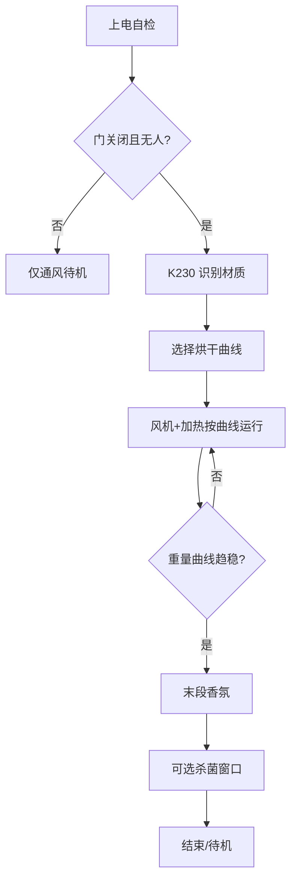

# 智能护衣系统 — 硬件与软件设计方案

> 依据《方案》手绘总体构想，采用 **双 STM32F407 + K230 + ESP32** 实现：分区护衣、环境感知、材质识别联动烘干策略、IoT 与本地人机交互。  
> **v1.1** 补充：数据融合细则、通信与标定要点、**端侧 + 融合 + 云端可选** 的 AI 架构及与晾衣项目的判干思路对齐。

---

## 一、项目概述

### 1.1 产品定位

**智能护衣系统**面向衣柜/护理柜形态，在「晾晒—烘干—杀菌—驱虫—香氛」全链路中，根据**衣物材质、重量变化、环境天气与气味**自动或半自动调节工作模式，并通过 **App 远程**与**串口屏本地**完成人机交互。

### 1.2 与手绘方案的功能对应

| 手绘要点 | 设计落点 |
|----------|----------|
| 上层挂衣、下层隐私区与鞋类平铺烘干 | 机械分区 + 独立温风/定时策略（可二期扩展多风道） |
| 底部烘干、杀菌区 | PTC/陶瓷加热、风机循环、UV 或臭氧（选型待定） |
| 顶层雨帘、风机、太阳能 | 雨帘驱动（舵机/步进）、多路风机 PWM、太阳能仅作辅助供电（可选 MPPT 模块） |
| 风/雨/雪检测 | 气象类传感器或风雨传感器 + 逻辑联动收帘/关外循环 |
| 拉力传感器 → 重量曲线 | F407 多路 ADC + 采样滤波，用于干湿趋势与负载检测 |
| 摄像头识别真丝/棉麻 → 冷风/恒温 | K230 运行轻量分类模型，结果下发主控切换烘干曲线 |
| 毫米波雷达 + 多普勒 | 人体接近/活动检测，安全联锁（开门停加热等） |
| 嗅觉传感器 | 异味等级或 VOC 趋势，辅助判断护理结束或触发通风 |
| 超声波驱虫、烘干末段香氛 | 超声换能器驱动模块、香薰继电器/微型泵定时 |
| IoT、串口屏、线路整理 | ESP32 负责联网；F407 接串口屏；强弱电分区与汇流排 |

### 1.3 设计原则

- **模块化**：传感、执行、视觉、联网分层，便于分板调试与后期更换传感器。
- **安全优先**：加热、UV、外伸机构与人体检测联锁；独立看门狗与过温保护（硬件或软件）。
- **可演进**：第一期可裁剪「太阳能、嗅觉、毫米波」中的部分，保留总线接口。
- **AI 可解释、可回退**：关键执行策略在端侧须有**规则/查表兜底**；AI 输出仅作加权或推荐，避免单点黑盒导致不可控加热。

---

## 二、机械与功能分区（逻辑）

```
┌─────────────────────────────────────┐
│  顶层：雨帘机构 + 太阳能（可选）      │
├─────────────────────────────────────┤
│  上层：挂衣区 — 主烘干风道、拉力传感  │
├─────────────────────────────────────┤
│  下层：隐私收纳 / 鞋类平铺区 — 弱风或定时│
├─────────────────────────────────────┤
│  底部：加热体、杀菌模块、风机进排风   │
└─────────────────────────────────────┘
```

- **风道**：建议进风经滤网 → 风机 → 可选加热 → 腔体 → 回风或直排（按结构密封性选型）。
- **模块化安装**：执行机构（帘、风门）与主控板通过接插件连接，便于在不同柜体上复用。
- **传感器布置（细化）**：拉力/称重尽量靠近**主受力路径**；柜内温湿度探头避开直吹热风区；摄像头视场覆盖**挂衣主区域**，补光与镜头距衣物建议在设计图中固定，便于后期视觉标定。

---

## 三、四芯片总体架构

### 3.1 角色分工

| 单元 | 型号 | 主要职责 |
|------|------|----------|
| **主控与决策** | STM32F407（下称 **F407-M**） | 业务状态机、烘干/杀菌/香氛/驱虫时序；汇总各传感器；与 K230、ESP32、F407-S 通信；接串口屏 |
| **传感与实时采集** | STM32F407（下称 **F407-S**） | 高速/多路模拟量：拉力（重量曲线）、嗅觉 ADC、气象数字接口；毫米波雷达数据解析（若模块串口输出） |
| **视觉与材质识别** | **K230** | 摄像头采集 + 推理：输出类别（如真丝 / 棉麻 / 未知）；不直接控大功率负载 |
| **联网与远程** | **ESP32** | Wi-Fi / 蓝牙（可选）；MQTT 或 HTTP 对接云与 App；可透传指令到 F407-M |

### 3.2 通信拓扑（推荐）

```
                    ┌─────────────┐
                    │   ESP32     │  Wi-Fi / App
                    └──────┬──────┘
                           │ UART(115200) 或 SPI 从机
                    ┌──────▼──────┐
                    │  F407-M     │◄──── 串口屏（UART）
                    │  主控       │
                    └──┬────┬──┬──┘
                       │    │  │
              UART/    │    │  └── UART ──► K230（材质结果 + 触发采集）
              CAN 可选 │    │
                       │    └────────────► F407-S（传感器批量数据 / 心跳）
                       │
                       └──────────────► 执行驱动板（可同板：继电器、MOS、预驱）
```

- **F407-M ↔ F407-S**：推荐 **UART + 简单帧协议**（长度、CRC、命令字）；距离远或干扰大时改用 **CAN**（F407 外接 CAN 收发器）。
- **F407-M ↔ K230**：**UART**，文本或定长二进制帧（材质 ID、置信度、时间戳）。
- **F407-M ↔ ESP32**：**UART** 为主；若 ESP32 做 Web 配网，可在启动阶段由 ESP32 开放热点。

### 3.3 为何使用两颗 F407

- **F407-S** 专注 **周期性 ADC DMA、多路传感器时间对齐**，避免与 **PWM、PID、屏刷新、多协议解析** 抢中断。
- **F407-M** 专注 **状态机与安全联锁**，对外统一「一台设备」逻辑，降低 K230/ESP32 的实时负担。

### 3.4 数据流（细化）

| 方向              | 内容                                 | 典型周期                                    |
| --------------- | ---------------------------------- | --------------------------------------- |
| F407-S → F407-M | 重量瞬时/滤波值、短窗口斜率与方差、气象汇总、雷达状态、VOC 等级 | 100 ms～1 s（原始内部）；**汇总帧** 10 s～60 s 或可配置 |
| K230 → F407-M   | 材质 ID、置信度、可选 ROI 质量分（过曝/模糊告警）      | 事件驱动（关门稳定后、或主控请求 `CMD_SNAP`）            |
| F407-M → 执行     | PWM 占空、加热/UV/香薰/超声/雨帘命令            | 控制环 10 Hz～100 Hz（加热 PID 另行设置）           |
| F407-M → ESP32  | 紧凑状态快照（模式、告警码、传感器摘要）               | 1 s～60 s（可随云端策略调整）；告警即时                 |

---

## 四、STM32F407-M（主控）设计要点

### 4.1 外设与接口（建议）

| 功能 | 接口 | 说明 |
|------|------|------|
| 串口屏 | USART + 可选 RST/背光 PWM | 自定义协议或 Modbus 屏 |
| K230 | USART | 材质识别结果、请求拍照 |
| ESP32 | USART | JSON/精简二进制上报状态、下发模式 |
| F407-S | USART 或 CAN | 订阅重量曲线块、气象、雷达状态 |
| 多路风机 PWM | TIM + 预驱 + MOS | 与现有大功率风扇方案衔接时注意电流与散热 |
| 加热/UV/香薰/超声 | GPIO + 继电器或专用驱动模块 | 与人体检测联锁 |
| 雨帘/风门 | 舵机 PWM 或步进 + 驱动器 | 限位开关推荐硬件接入 |

### 4.2 核心软件模块

- **状态机**：`待机 / 通风 / 烘干-冷风 / 烘干-恒温 / 杀菌 / 驱虫 / 异常停机`
- **模式表**：根据 K230 输出选择温度上限、风速曲线、最长时长。
- **联锁**：毫米波或门磁触发 → 关闭加热与 UV；恢复后需人工确认或延时再启。
- **香氛策略**：在烘干流程**最后 N 分钟**或**湿度/重量趋势达标后**触发（与手绘「烘干最后时间放香氛」一致）。

### 4.3 状态迁移与安全优先级（细化）

- **优先级（高→低）**：硬件过温 / 急停 > 门开或人体存在 > 通信丢失（F407-S/K230 心跳超时策略可配置）> 风雨强信号关外循环 > 正常业务流程。
- **建议**：各状态进入/退出条件写入**一张表**（条件位掩码 + 目标状态），便于单元测试与 SIL 仿真。
| 告警/条件 | 默认动作 |
|----------|----------|
| 过温（硬件或 NTC） | 立即断加热，风机按散热曲线运行 |
| 门开或雷达「有人」 | 关加热、关 UV；风机可维持低速通风 |
| F407-S 心跳超时 | 降功率或停机（可配置）；屏与 ESP32 提示 |
| K230 低置信度多次 | 切换保守曲线，并提示用户确认材质 |

### 4.4 参数与标定（建议持久化到 EEPROM/Flash）

- 称重零点、满量程系数（分区可各自一套）。
- 各模式下温度上限、最长运行时间、香氛提前量。
- **AI 相关**：材质→曲线映射版本号；判干模型/阈值版本号（便于 OTA 后与旧参数区分）。

---

## 五、STM32F407-S（传感）设计要点

### 5.1 采集对象

| 传感器 | 接口 | 处理 |
|--------|------|------|
| 拉力 → 重量 | 桥式 + 仪表放大 → ADC | DMA 循环采样、滑动平均、校准零点 |
| 嗅觉（VOC/电子鼻模块） | 模拟电压或模块 I²C/UART | 归一化趋势，供主控判断「是否需要延长通风」 |
| 风雨雪 | 数字模块或开关量 + ADC（雨量） | 防抖；结果上报主控驱动雨帘 |
| 毫米波雷达 | UART 或 GPIO 存在信号 | 解析人体存在/距离档位 |
| 柜内温湿度（可选） | I²C | 供环境监测与功率修正；**不作为唯一判干依据**时与晾衣方案一致（见同仓 `smart_wardrobe/AI干湿检测判断依据.md`） |

### 5.2 重量曲线

- 固定周期（如 10 s～60 s）上传**当前重量、斜率、方差**等特征，而非裸 ADC 洪流，减轻总线负载。
- 与项目内《智能晾衣架》类文档中「重量判干」思路兼容，本系统额外叠加**材质权重的烘干终止条件**。

### 5.3 上报特征定义（建议字段）

便于后续 **端侧小模型或规则融合**，F407-S 除原始重量外建议计算并上传：

| 字段 | 含义 | 说明 |
|------|------|------|
| `w_filt` | 滤波后重量 | 如指数滑动平均 |
| `slope_5m` | 近 5 min 线性斜率 | 负值表示仍在失水 |
| `var_short` | 短窗方差 | 抖动大可能挂钩不稳或风扰 |
| `plateau_score` | 平台度指标 | 例：斜率绝对值低于阈值且持续 M 分钟则趋近干爽 |
| `tick` | 单调时间戳 | 与 K230、主控对齐 |

---

## 六、K230（视觉）设计要点

### 6.1 功能边界

- 输入：柜内固定角度摄像头（补光建议：940 nm 红外或低发热白光，避免损伤真丝）。
- 输出：**材质类别 ID** + **置信度**；低置信度时 F407-M 走「保守模式」（低温、限时）。
- **多件衣物限制**（与 `smart_wardrobe/AI功能优化方案.md` 中讨论一致）：单帧多目标易混类。对策：**默认识别视场中心 ROI**；App/屏提供「当前关心的一件」提示；或**流程上打开门后用户整理为单件主衣再识别**。

### 6.2 与主控交互（建议协议字段）

- `CMD_SNAP`：主控请求采集一次。
- `RSP_MATERIAL`：`{id, confidence, ts}`，id 枚举如 `SILK, COTTON_LINEN, UNKNOWN`。
- **扩展（AI 向）**：可选 `image_quality`（过曝/模糊）、`secondary_id`（第二候选类），供主控记录与云端分析，不强制一期实现。

### 6.3 策略映射（与手绘一致）

| 识别结果 | F407-M 策略摘要 |
|----------|-----------------|
| 真丝（高置信度） | 冷风或低温上限（如 ≤40°C 等，以实测标定为准）、低风速渐变 |
| 棉麻 | 允许较高恒温段、中等风速 |
| 未知 | 默认保守曲线 + 缩短单次最长运行时间 |

### 6.4 模型生命周期（AI 工程化）

- **采集**：脱敏后的裁剪图 + 标签（材质）+ 工况（温区、补光档位）入库路径预留（经 ESP32 或离线导出）。
- **训练**：PC 或服务器上迭代；量化导出为 K230 可用格式。
- **部署**：版本号随镜像下发；F407-M 记录 `model_ver` 便于追溯。
- **A/B**：可保留两档模型，低置信度样本自动走保守策略。

---

## 七、ESP32（IoT）设计要点

### 7.1 功能

- **配网**：SmartConfig / BLE / 热点 Web 配网（择一）。
- **上行**：设备状态、告警、当前模式、传感器摘要（由 F407-M 打包经 UART 发出）。
- **下行**：远程启动/停止、模式切换、预约（主控校验合法性后执行）。

### 7.2 安全建议

- TLS 接入云端；设备证书或 Token；防重放可在 F407-M 做简单序号校验。

### 7.3 与 AI 云侧衔接（可选）

- **Telemetry**：周期性上传「特征向量」而非全量原始波形（降流量、降隐私风险）：重量斜率、VOC 趋势、模式、时长、判干结果、手动纠正标记。
- **用途**：家庭内可选择**不开云**；若开启：用于**模型再训练、异常检测基线、能源统计**，不负责实时闭环控制（实时仍在 F407-M）。

---

## 八、执行器与电气清单（汇总）

| 类别 | 项目 | 备注 |
|------|------|------|
| 风路 | 12V 风机若干 | 可参考同目录《风扇接线方案.md》中的电流与线径设计 |
| 加热 | PTC 或陶瓷加热片 + 温控 | 过温保护开关串联 |
| 杀菌 | UV 灯管/LED 或臭氧模块 | 人体联锁必须 |
| 雨帘 | 舵机或步进 | 遇风雨信号自动关闭外口 |
| 驱虫 | 超声发射模块 | 注意频率与占空比，避免扰民（柜体隔音） |
| 香氛 | 微型泵或电磁阀 + 储液 | 仅在允许阶段开启 |
| 供电 | 主电源 + 可选太阳能 MPPT 充锂电池 | 太阳能与市电切换需防反灌 |

---

## 九、关键业务流程（简图）



- **并行**：风雨信号随时打断「外循环」或触发雨帘；优先级由 F407-M 仲裁。
- **细化**：`G` 可与 **第十节「融合判干」** 一致：重量平台度 +（可选）VOC 回落 + 最大时长，三者逻辑由配置表决定。

---

## 十、智能判干与多模态融合（细化，对接 AI）

### 10.1 融合判干（端侧优先）

**目标**：减少「靠手摸」与过度烘干，与晾衣架文档中「重量为主、环境湿度为辅」一致。

| 信号 | 角色 |
|------|------|
| 重量曲线斜率趋零 + 平台持续 M 分钟 | **主判据** |
| VOC/异味趋势下降 | **辅助**（提示可结束通风或进入香氛） |
| 柜内湿度（若有） | **环境修正**，不参与单独决断时可关闭 |
| 运行累计时长 / 模式表上限 | **硬封顶** |

**输出**：`dry_confidence`（0～1）或离散 `{未干 / 接近 / 已干 }`，供状态机与 App 展示。

### 10.2 AI 增强路径（由浅入深）

1. **规则 + 加权打分（一期即可称「智能」）**  
   各特征归一化后加权求和，权重按材质从模式表读取（真丝更信重量平台、弱风速段）。

2. **端侧轻量回归/小网络（F407 或 K230 空闲时）**  
   输入：短序列特征（过去 30～60 min 斜率、方差、VOC）；输出：`dry_confidence` 或剩余时间估计。须保留**规则兜底**，防推理异常。

3. **云侧或离线训练的用户/柜体自适应（可选）**  
   用 Telemetry 学习该用户「收衣习惯纠正」与本地称重特性，周期性更新端侧阈值包（不经由实时链路控制加热）。

### 10.3 与纯视觉识别的分工

- **视觉（K230）**：解决「怕烘坏」——**材质敏感**的温度/风速上限选取。
- **重量/VOC 时间序列**：解决「怕没干透 / 怕过度烘干」——**进程判断**。
- 二者合并才是完整「智能护衣」叙事，避免仅为贴「AI」标签而重识别、轻判干。

---

## 十一、AI 方向总览：分层与产品叙事

```
┌─────────────────────────────────────────────────────────────┐
│  交互层（可选）   App 自然语言说明 / 运维对话 — 云端 LLM       │
├─────────────────────────────────────────────────────────────┤
│  学习与分析层（可选）  模型训练、异常基线、用电与报表 — 云    │
├─────────────────────────────────────────────────────────────┤
│  边融合层            F407-M：多源特征融合 + 规则兜底 + 状态机   │
├─────────────────────────────────────────────────────────────┤
│  端智能层            K230：材质/缺陷轻量分类；可选序列判干     │
│  端采集层            F407-S：高质量传感特征与时间对齐          │
└─────────────────────────────────────────────────────────────┘
```

- **端侧 AI**：K230 材质分类；未来可扩展「皱褶/霉变初筛」等图像类任务（需合规与隐私说明）。
- **融合「AI」**：以传感器时间序列为核心的 **干湿预测、剩余时间估计、异常趋势（VOC 突升）** — 不要求大模型，但属于经典机器学习/信号智能范畴。
- **云端 AI（弱耦合）**：个性化阈值、模型版本分发、家庭能源优化建议；**不做硬实时控制**。
- **对话式体验**：ESP32 上行至 App 后，由云端大模型解释「为何进入保守模式」「预计多久干」——与实时控制解耦，降低安全风险。

---

## 十二、线缆与结构（回应手绘「线路问题」）

- **分区**：强电（加热、风机）与弱电（MCU、传感器）分线槽；接插件统一型号与线序表。
- **接地**：金属柜体与电源地合理汇接，避免传感器地漂。
- **EMI**：风机 PWM 线与模拟传感器线分开捆扎；K230 摄像头用屏蔽线。

---

## 十三、开发阶段建议（细化）

| 阶段 | 内容 | 验收要点 |
|------|------|----------|
| **P0** | F407-M 单板 + 屏 + 风机 + 加热 + UART 假数据 | 状态机完整、联锁可用、加热异常可切断 |
| **P1** | F407-S：拉力 + 一门磁/雷达；双机串口协议 + CRC | 特征帧速率与丢包率达标；心跳恢复策略 |
| **P2** | K230 材质识别联调；模式表绑定 | 低置信度保守模式；ROI/多件策略验证 |
| **P3** | ESP32 上云与 App；状态快照与 OTA 通道雏形 | TLS、远程指令鉴权；模型版本可追溯 |
| **P4** | 嗅觉、超声、雨帘、太阳能增量 | 按优先级插入状态机；不误触发驱虫 |
| **P5（AI+）** | 融合判干权重标定；可选端侧小模型或云侧阈值包 | 与手摸/称重对照实验；能耗对比 |

---

## 十四、文档与工程索引

- 大风量风机接线与安全：见同目录 `风扇接线方案.md`（若存在）。
- 重量判干与传感器主次关系：`smart_wardrobe/AI干湿检测判断依据.md`
- AI 价值定位与模式推荐：`smart_wardrobe/AI功能优化方案.md`
- 晾衣架系统级参考：`smart_wardrobe/智能晾衣架系统最终方案.md`

---

## 十五、修订记录

| 版本 | 日期 | 说明 |
|------|------|------|
| v1.0 | 2026-03-24 | 初版：四芯片架构、分区、传感器与业务流程 |
| v1.1 | 2026-03-26 | 细化：数据流、状态优先级、F407-S 特征字段、融合判干与 AI 分层；K230 模型生命周期；与 smart_wardrobe AI 文档对齐；多件衣物视觉对策 |

---

**说明**：具体引脚分配、BOM 电流核算与结构图纸需在定型柜体尺寸后另文《硬件详细设计》补充；本文作为系统级方案基线。
