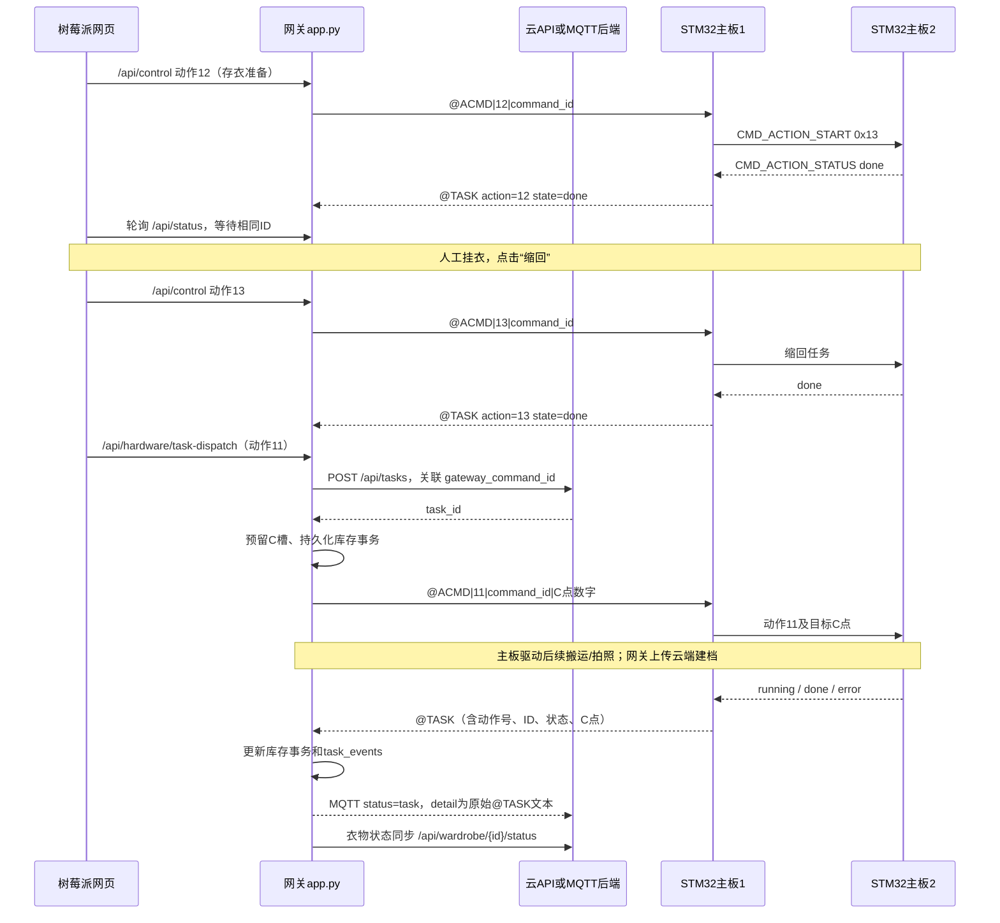

# 接口与执行链路（以包内当前源码为准）

## 入口与责任划分

另一路入口是云端发布MQTT JSON：`MqttBridge.on_message → _send_commands → 库存校验 → 串口`。这条路径直接进入命令处理，不调用 `_dispatch_hardware_task` 创建云端任务。后端需自己关联其已有任务记录。

本地源码没有轮询云端任务列表并逐条自动执行的worker；前端读取 `/api/tasks` 是显示任务列表。不能只在云数据库插入任务就认定硬件会执行。云端是否存在独立调度worker，本包无法证明。

## HTTP接口

| 接口 | 当前行为 |
|---|---|
| `POST /api/hardware/task-dispatch`（网关） | 接收 `task` 与 `command`；先创建云任务，再下发串口；串口失败会尝试DELETE云任务或标记send_failed。返回HTTP200也可能`ok=false`，必须检查JSON字段 |
| `POST /api/control`（网关） | 动作12/13/14等非库存控制可用；动作6/7/11返回409，要求使用task-dispatch |
| `POST /api/tasks`（网关） | 精确路由返回409，封锁旧网页两步流程 |
| `POST /api/tasks`（远端云API） | 网关内部调用的建任务接口；与网关同名路径含义不同 |
| `GET /api/status` | 网关连接状态、last_command、task_events、日志等 |
| `GET /api/inventory` | 持久化槽位、事务、活动事务和云同步状态快照 |
| `GET /api/serial/logs?limit=300` | 有限长度内存日志；重启会丢失，及时采集 |
| `/api/cloud/{path}` | 云API透传入口，调用前核对实际主机/端口和方法 |

`task-dispatch`是应用层顺序操作加失败补偿，不是数据库与硬件之间的严格分布式原子事务。不要仅依据接口名称假设崩溃恢复或并发下恰好执行一次。

## MQTT接口

源码默认broker：`broker.emqx.io:1883`。部署可由 `WARDROBE_MQTT_HOST/PORT/USER/PASSWORD/COMMAND_TOKEN` 覆盖；默认值不是本轮确认的现场值。

| 方向 | 主题 |
|---|---|
| 主命令主题默认值 | `smart_wardrobe/raspberry-pi-wardrobe-001/cmd` |
| 兼容命令主题（同时订阅） | `smart_wardrobe/k230-wardrobe-001/cmd` |
| 主状态主题默认值 | `smart_wardrobe/raspberry-pi-wardrobe-001/status` |
| 兼容状态主题（同时发布） | `smart_wardrobe/k230-wardrobe-001/status` |

代码订阅/发布QoS为0。两个状态主题可能承载同一事件；后端订阅两者时要识别重复消息。`queued/cloud_rx`只说明网关收到了JSON；`sent/uart_tx`表示命令处理返回成功，既可能是串口写成功，也可能是同一运行中库存任务被判定为已下发而没有再次写串口。**这两种状态均不表示机构完成。**

实际硬件终态示例见 `接口样例/mqtt_terminal.json`：外层是`status=task`、`stage=board1_task`、`command_id=""`；需从detail内解析 `id`、`action`、`state`、`target_c`。当前代码并未在这个分支自动调用云任务的完成更新API。后端是否另有MQTT消费闭环需确认。

## 动作号

| action_id | 执行位置 | 语义及后续 |
|---|---|---|
| 0 | 主板1/2 | 停止动作；用于故障处置，不能当正常完成 |
| 5 | 主板2 | 单步伸缩调试，不属于完整存衣流程 |
| 6 | 主板2 | 完整存衣动作，必须有合法目标C点；网关负责库存预留 |
| 7 | 主板2 | 指定衣物/真实C点取衣，网关一次处理一件；页面完成后等待人工取衣及动作14 |
| 8/9 | 主板1 | 热风移动启动/停止，和主板2存衣动作不是同一机构 |
| 10 | 主板2 | 刷毛动作 |
| **12** | 主板2 | **到A0、伸出后结束；网页等待人工挂衣** |
| **13** | 主板2 | **存衣固定行程缩回后结束；网页收到done才发送11** |
| **11** | 主板2 | **缩回后的后续存衣、拍照与入目标C点** |
| 14 | 主板2 | 取衣后缩回、XYZ到A0、舵机复位；依赖软件累计位置，不等于物理寻零 |

不要为了让伸出后的机构“接着动”而直接将12改成6或绕过人工确认。先根据真实下发链路确认上层期望和机构当前状态。

## 串口与板间协议

树莓派CH340 TX→主板1 PD9/USART3_RX，RX←PD8/USART3_TX，共地，115200/8N1。源文件/历史文档仍有K230名字，当前主线网关是树莓派。

网关发文本并加换行：`@ACMD|动作号|command_id|target_c数字\n`，最后的C点字段可省略；C01通过网关编码为1。动作6/7/11必须获得合法目标1–12，否则主板2拒绝。其他协议：`@MCMD`电机、`@SCMD`舵机、`@OCMD`主板1输出。

**文件夹名 `USART1.DMA` 不等于主板1当前实际UART。** 当前主板1板间实现使用USART2、PD5/PD6（CN5）；主板2使用USART1、PB6/PB7。需现场核对连线及烧录版本。

板间7字节帧：`FF cmd channel control angle_hi angle_lo checksum`。`CMD_ACTION_START=0x13`携带动作号与目标C点；`CMD_ACTION_STATUS=0x12`回传动作号、状态码、C点。状态码：1 running、2 done、3 stopped、4 error、5 busy；主板1把busy映射为文本error。板间帧不携带完整command_id，主板1只维护一个当前主板2任务ID，必须串行衔接。

主板2 `Board2_LinkTaskStatusService()` 根据动作状态机结果回传终态并清理跟踪状态；主板1收到终态才清掉 `g_pi_gateway_board2_active_action_id`。回执中断可能让主板1持续拒绝新动作。

## 事务和ID

区分：云 `task.id`、网关 `command.id`、串口截断后的ID、云任务 `payload.gateway_command_id`、衣物 `item_id`、目标 `target_c`。不能互相替换。

当前 `protocol.clean_text()` 默认24字符；`action_line()`沿用它。主板1缓冲区即使已扩为64字节，也无法恢复网关发送前已经截掉的后缀。排查时先用短ASCII且每任务唯一的ID做软件对照，并保存完整映射。

库存相关动作6/7/11只允许一个 `reserved/running` 活动事务。缺少终态会阻塞后续事务；相同运行中ID不重复下发，相同完成ID被拒绝。存衣硬件done但缺少建档item_id时进入`awaiting-cloud-item`并保留槽位，不能据此宣称衣物建档/入库全部完成。
